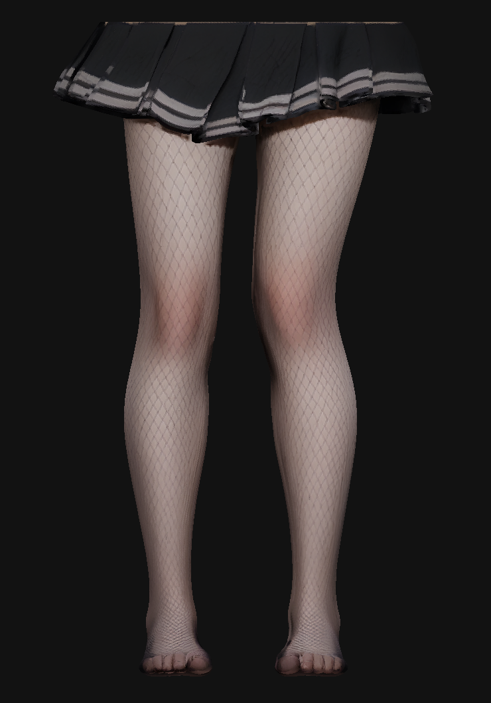

# NYLON · Elastic Studio

一个可直接运行的 3D 丝袜拉伸实验：使用提供的真实 OBJ 模型，以照片手部光标捏住袜层、向外拉离腿部，并在松开后弹性回弹。支持原始贴图、透肤、缎面、厚袜、渔网和蕾丝外观。

**[在线演示](https://nylon-elastic-studio-nov10.majorsnail16384.chatgpt.site/)** · [制作过程](docs/MAKING_OF.md) · [技术细节](docs/TECHNICAL.md) · [运行与部署](docs/RUNNING.md) · [资源说明](docs/ASSETS.md)

**下载：[单文件离线演示](https://github.com/engrecho/nylon-elastic-studio/releases/download/v0.4.0/NYLON-offline.html) · [完整运行包](https://github.com/engrecho/nylon-elastic-studio/releases/download/v0.4.0/nylon-elastic-studio-v0.4.0.zip) · [版本说明](https://github.com/engrecho/nylon-elastic-studio/releases/tag/v0.4.0)**

> 在线入口在 2026-11-11 的直接 HTTP 检查中返回 200。此检查不等同于完整的浏览器视觉验收。项目是实时视觉交互原型，鼠标位移代替拉力输入，无实体触觉反馈。

<p align="center"></p>

*上图由实际模型和原贴图进行 CPU 正面渲染，用于检查几何与 UV；不是网页截图，也不是 AI 生成的替代模型。*

## 可以体验什么

- **局部捏持**：在任意一条腿的袜层按下并拖动，拖得越远，局部抬起越明显；弹性参数会影响相同鼠标位移下的拉伸响应。
- **松手回弹**：弹簧阻尼积分恢复贴合；拖动一条腿不会带动另一条腿。
- **手图交互**：使用提供的透明手图，指尖跟随实际被拉起的布料顶点；可调整大小或切回普通鼠标。
- **材质更换**：原始贴图及五种袜类；调整颜色、DEN 厚度和弹性。渔网有透明孔洞，缎面与厚袜具有不同光泽和覆盖率。
- **原模对照**：保留原始模型，可暂停拉伸并对照原貌。
- **两种精度**：默认 18 万面预览；服务版可切换到完整约 150 万面原模。
- **离线使用**：生成一个内嵌模型、贴图、Three.js 和手图的 HTML 文件。

## 快速运行

需要 **Node.js 22+**、支持 WebGL 和 `DecompressionStream` 的现代 Chrome / Edge。仓库已包含运行所需的模型与静态资源，**启动演示不需要安装构建依赖**。

```sh
git clone https://github.com/engrecho/nylon-elastic-studio.git
cd nylon-elastic-studio
npm start
```

打开 **http://localhost:5188**。首次加载要解码模型与 4K 贴图，请等待加载提示消失。

| 操作 | 效果 |
| --- | --- |
| 按住袜层向外拖动 | 捏住并拉起局部布料 |
| 松开鼠标 | 布料回弹 |
| 在空白处拖动 | 旋转模型 |
| Shift + 滚轮 | 缩放 |
| “体验一次拉伸” | 自动演示拉起和回弹 |
| “原模对照” | 暂停拉伸并显示原模型 |
| “模型精度” | 切换轻量预览 / 完整原模 |
| “重置” | 恢复材质、视角和袜层状态 |

## 离线版与检查

```sh
# 生成单文件离线版，无需额外依赖
npm run build:offline

# 验证原模、袜层、回弹、手部光标和离线资源
npm test
```

使用 Chrome / Edge 直接打开 `outputs/NYLON-offline.html`。离线单文件约 32 MB，内嵌轻量预览，不包含完整精度切换资源。完整原模请通过本地服务器或在线版使用。

只有重新处理原始 OBJ 时才需要开发依赖：

```sh
npm ci
# 将原始 OBJ + MTL + 四张 PBR 贴图放入 reference-model/
npm run prepare:model -- reference-model/source.obj
npm run build:offline
npm test
```

输入文件约定、部署方式、常见故障见[运行与部署](docs/RUNNING.md)。

## 模型与实现概要

| 层级 | 顶点数 | 三角面数 | 用途 |
| --- | ---: | ---: | --- |
| 完整原模（含 UV 接缝拆点） | 863,144 | 1,499,482 | 保留全部原始面片与坐标 |
| 轻量预览 | 160,176 | 180,000 | 默认显示，降低载入与渲染成本 |
| 独立动态袜壳 | 25,616 | 35,000 | 局部形变和回弹 |

完整精度只进行可逆的坐标居中与缩放，不主动调整腿型。轻量预览与袜壳从原模抽取和简化；简化器报告的预览相对几何误差约 `0.000202`，不是所有细节无损的承诺。

运行时保留**不变的身体网格**，只更新独立袜壳。抓取采用射线选点、局部距离衰减、弹簧阻尼积分和表面法线方向的局部碰撞约束。材质着色器处理织纹、网孔、光泽和拉伸透光。完整公式、二进制格式与代码入口见[技术细节](docs/TECHNICAL.md)。

## 制作过程

1. **参数化交互原型**：先验证鼠标抓取、局部拉伸与阻尼回弹。
2. **双腿与材质预设**：建立双腿演示、丝袜类型与材质控制。
3. **照片手部光标**：将提供的透明手图接入实际抓取点。
4. **真实模型接入**：读取提供的 OBJ + PBR 资源，保留原模，制作轻量预览和独立袜层，替换程序化腿型。
5. **发布整理**：整理运行脚本、自动化检查、离线生成器、制作记录和技术文档。

详细说明包括为什么单张截图不能无损重建可旋转模型、整体网格如何拆出袜层，以及原贴图的限制，见[制作过程](docs/MAKING_OF.md)。

## 已知限制与验证边界

- 原模型的丝袜纹路烘焙在颜色贴图中，没有独立裸肤贴图。换袜后的底层肤色由着色器**近似重建**，不能恢复扫描级真实皮肤；原始贴图模式保留原纹路。
- 物理部分是局部视觉近似，不是经过实测标定的有限元求解器；只有局部法线约束，没有完整全局身体碰撞与布料自碰撞。
- 手是二维照片叠加，不是可独立弯曲手指的三维骨骼手。
- 距离、张力、DEN 预设是交互演示参数；不能作为实际织物测量数据。
- 已检查原模面数、袜壳顶点来源、局部捏持、跨腿隔离、局部碰撞约束、回弹、重置、离线资源和手图状态；做过实际几何与贴图的 CPU 渲染。**最终 GPU 着色器、浏览器画面与移动端触控尚未完成视觉验收**。

## 资源与许可

Three.js 和模型准备依赖保留各自许可证。模型、贴图及手部照片由项目制作时提供，发布到此仓库不代表自动授予这些素材的二次使用许可。项目尚未指定统一的开源许可证，详见[资源说明](docs/ASSETS.md)。
