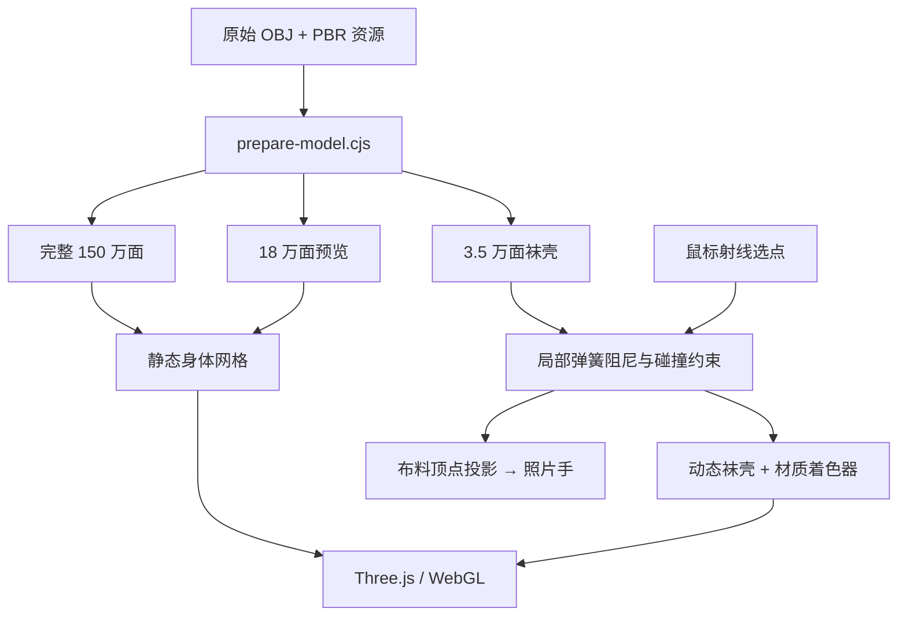

# 技术实现

## 分层结构



## 代码入口

| 文件 | 职责 |
| --- | --- |
| `dist/app.js` | 场景、灯光、相机、加载、控制面板、射线抓取、材质注入、动画循环 |
| `dist/model-loader.js` | 解压几何、恢复属性、计算法线、加载纹理 |
| `dist/cloth-physics.js` | 独立的局部布料数值模型 |
| `dist/hand.js` | 透明照片光标与抓取点对齐 |
| `prepare-model.cjs` | OBJ 解析、模型分级、袜壳提取、资源转换、CPU 检查渲染 |
| `make-offline.cjs` | 内嵌脚本、轻量几何、纹理与手图，生成单文件 HTML |
| `serve.cjs` | 本地静态资源服务 |
| `check-integration.cjs` | 原模、袜层、回弹、隔离与离线资源验证 |
| `check-hand.cjs` | 光标状态与定位验证 |

## 几何转换与保形边界

OBJ 以 `(位置索引, UV 索引)` 为键建立索引几何，因此原始 749,723 个位置顶点在 UV 接缝拆点后变成 863,144 个运行顶点。完整版本保留原始所有面片，法线重新计算。

显示坐标进行可逆归一化：

```text
x' = (x + 0.005175) × 6.3
y' = (y - 1.073938 / 2) × 6.3
z' = z × 6.3
```

这使相机和交互参数有统一尺度，不是人体尺寸标定。

预览使用 `simplifyWithAttributes`，目标 180,000 面，UV 权重 `[0.01, 0.01]`，请求误差 `0.0006`；实际报告误差约 `0.0002024253`。简化复用原始顶点，只改变保留的面片 / 索引。误差指标不是绝对无损保证，细节是否可见还与相机和材质有关。

袜壳提取原始模型中三个顶点高度均小于 `0.855` 的三角形，再简化至 35,000 面，使用 `RegularizeLight`。实际报告相对误差约 `0.0007320991`。提取高度是当前模型专用值，不是通用人体分割器；更换模型时应重新检查裙摆与袜口边界。

## 几何文件格式

`dist/model/*.bin.gz` 是手动 gzip 压缩的数据。浏览器 `fetch` 读取后通过 `DecompressionStream('gzip')` 解压。内部为小端序：

| 偏移 | 内容 |
| --- | --- |
| 0–3 | ASCII `NYL4` |
| 4–7 | 顶点数，uint32 |
| 8–11 | 索引数，uint32 |
| 12–15 | 保留字节 |
| 16 起 | `vertexCount × 3` 个 float32 位置 |
| 随后 | `vertexCount × 2` 个 float32 UV |
| 最后 | `indexCount` 个 uint32 索引 |

载入时核对 magic 和总长度；不将输入当作脚本执行。渲染法线由几何计算。每个模型的实际计数记录在 `dist/model/manifest.json`。

## 抓取与形变

1. 相机射线与袜壳相交，得到抓取点 `g` 和法线。
2. 在与相机视线垂直、通过抓取点的平面上计算鼠标位移。
3. 混合切向位移与向外法线位移，按弹性设置调整，最大位移限制为 `1.6` 个显示单位。
4. 选择最近的袜壳顶点作为手部显示锚点；整块布料受连续权重影响。

当前局部权重为：

```text
spread = 0.38 + |pull| × 0.36
w = exp(-2.2 × (distance(vertex, g) / spread)^1.6)
```

权重还乘以脚部 / 袜口固定系数；另一条腿的顶点通过 X 轴符号隔离。这依赖当前双腿的摆放方式，不是通用身体语义分割。

## 弹簧阻尼与碰撞

每个顶点保存基准位置、法线、位移和速度。受控目标位移是 `pull × w`：

```text
k = 70 + elastic × 1.6
c = 2 × sqrt(k) × 0.7
acceleration = k × (target - displacement) - c × velocity
velocity += acceleration × h
displacement += velocity × h
```

帧时间限制在 `0 … 0.04` 秒，内部积分子步不超过 `1/120` 秒。松手将目标归零，阻尼使袜层回到静态位置。

碰撞采用基准表面法线的局部半空间约束：若 `dot(displacement, normal) < 0`，移除向内位移和向内速度。袜壳沿法线额外偏移 `0.014` 单位，以减少简化误差导致的重叠。

这没有对全部身体三角形进行全局连续碰撞检测，没有布料自碰撞，也没有基于纱线的边长约束。局部视觉形变比完整织物物理解算更轻量，但可能在大幅切向拖动、复杂姿态和极端视角下出现近似误差。

## 材质

- **原始模式**保留原颜色贴图，静止外观以源模型为基础。
- **新袜类**使用程序化织纹、透明度、粗糙度与 sheen；渔网用菱形距离场和 `discard` 形成真实透明孔洞，蕾丝用程序化图案近似。
- **拉伸透光**根据局部位移减小袜层覆盖率。
- **肤色重建**对原颜色贴图作低频采样并混合近似肤色，避开直接把烘焙袜纹当作裸肤。它不能恢复输入中不存在的真实皮肤信息。

当前主渲染路径使用颜色与粗糙度贴图；原包的法线和金属度贴图保留在资源中，但未直接用于交互材质，避免把已有袜纹凹凸再次带入重建肤色。

## 手图与离线包

手图在模型区域以 CSS 覆盖显示，热点为原图的 `(15.2%, 21.1%)`。抓取时读取实际形变顶点，变换到世界坐标，再投影到屏幕；图片载入失败时恢复普通光标。旋转 / 缩放反馈不会产生独立手指动作。

离线生成器内嵌 Three.js、应用模块、手图、轻量预览、袜壳、颜色与粗糙度纹理，并移除网络字体依赖。完整 150 万面模型未内嵌；离线模式选择它时会说明应改用服务版。

## 验证

自动检查覆盖：原模 / 预览 / 袜壳计数、袜壳顶点来自原模、局部位移、另一条腿不动、法线约束、回弹到阈值、身体数组不变、重置、离线资源、手图回退与状态。它们不验证 GPU 着色器编译、像素外观或移动端操作。
